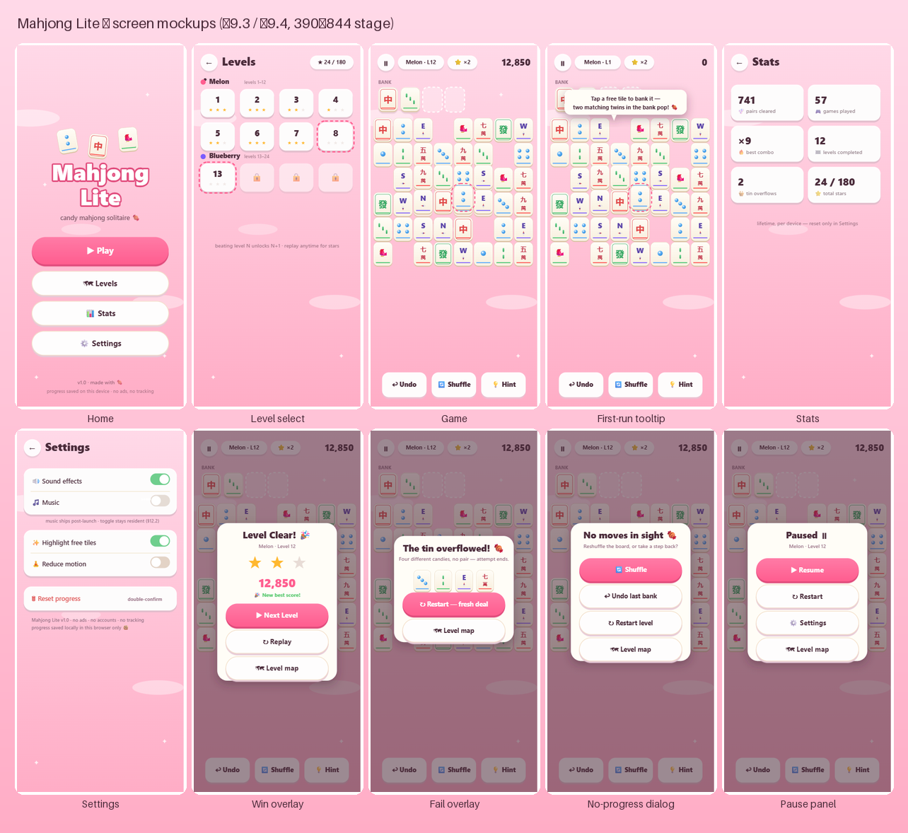

# Mahjong Lite — Game Design Document

| | |
|---|---|
| **Working title** | Mahjong Lite — *locked placeholder for the build*; final rename is a ship-time search/replace across manifest/README/title (rename ideas: *Mahjong Pop*, *Tile Pop!*) |
| **Genre** | Casual puzzle — mahjong solitaire (tile-matching) |
| **Platform** | Web (mobile-first), static files on GitHub Pages |
| **Reference game** | *Mahjong Blast* by Nebula Studio (iOS/Android) |
| **Doc version** | v0.3.11 — bugfix: **iOS 26 standalone scrim gap** — fixed body-level full-screen layers (`#bg`, `.overlay`, `#splash`) now carry explicit `height: 100lvh` (+ `100vh` fallback) alongside `inset: 0`, because iOS 26 WebKit in home-screen/standalone mode can stop fixed layers short of the screen bottom (the reported pause-scrim gap; partially fixed upstream in iOS 26.1, §15). Supersedes v0.3.10 — copy change: every levels-page reference reading "Level map"/"Map" now reads **"Levels"** (`src/data/i18n.js` STR keys `map`/`dlgMap`/`pMap`/`mapBtnAria` + the §9.3 mockup generator labels + §3.6/§9.4-§9.5 prose/flow above); the page title itself was already `levelsTitle: 'Levels'`. Identifiers (`goMap`, button ids, STR key names) are unchanged plumbing. Supersedes v0.3.9 — user feedback: **SFX volume** — the master bus plays at **×1.4** (uniform multiplier on the `SfxBus` master gain, `SFX_LEVEL` in `src/view/audio.js`): every included sound effect is slightly louder while the tuned relative mix (pop vs bell vs thock) is preserved exactly; peak stacked voices stay far below the clip ceiling. Supersedes v0.3.8 — user feedback: **bank left-pack + ivory bloom sky** — (1) when a match pops, the tin compact: the state bank is **left-packed on every pop** (no banked tile ever keeps an empty slot to its left; order is rule-neutral, snapshots stay gapless so undo is free), and the tin minis are now **face-keyed** (`src/view/board-render.js`) — every landing runs a **staggered ~220 ms glide** (60 ms per tile cascade) as the popped pair bursts out (supersedes the v0.3.7 slot-indexed mini plumbing; `slotFlights` is keyed by face); (2) the Bubblegum Beach sky gains a slow **ivory bloom**: a huge soft white glow (`#bg::after`, opacity ≤ 1, transform+opacity only — no per-frame repaint) drifts diagonally and breathes over ~14 s (§10.4 amended — a "gentle but visible" ambient level per user); it freezes to the static sky under reduced motion. Supersedes v0.3.7 — user feedback: **portrait tin + state-first bank reconcile** — bank slots resize from 54×54 squares to portrait ~57×78 (5:7 like the tiles: slot content box = the exact board-tile cell ≈52×73, sprite minis fill it edge-to-edge), landing settle 1.0 (supersedes §9.5's 78% settled mini), tin strip 70→80 px (consumes the board's 10 px fit slack exactly — tiles stay 72.75 px tall, §14.2 untouched); the tin DOM is now a state-first projection: every landing reconciles the slot minis against `state.bank` (in-flight slots keep their pending mini until touchdown) — fixes the invisible-banked-tile bug where a rapid tap/pop ordering could delete a pending mini and leave an occupied slot visually empty forever. Supersedes v0.3.6 — user feedback: **boot splash** — a self-contained pre-boot loading cover (static HTML + inline CSS, zero external requests) paints as the first thing on every load, covers the entire window, holds ≥ 600 ms so it never blips past, and fades to Home once all loading and initialisation completes (§8.3 amended — supersedes the "no splash screen" line for *boot only*; level entry keeps the no-splash board shimmer). A failed boot keeps the splash up with an error line instead of stranding a blank app. Supersedes v0.3.5 — user feedback: **1.5×-tile board re-sculpt** — the board canon collapses to **5 columns × 4–8 rows** (§7.1, supersedes the v0.3.3 `cols = 8` lock; the §14.2 fit now yields ≈52 × 72.75 design px portrait tiles, ≈1.46× the v0.3.4 size — the 7-layer spread consumes the literal-1.5× margin) and **max stack depth rises 5 → 7 layers** (§6 band layer ranges widen accordingly; all 60 tile counts, names, hidden counts and §6 band edges unchanged — `build-levels.mjs` re-sculpts silhouettes as 5-wide towers). Supersedes v0.3.4 (user feedback: user-sourced **pixel-art tile sprites** replace the procedural SVG faces (`assets/tiles/*.png`, §10.3); **tiles redesigned to portrait 5:7** (§14.2 fit formula + board geometry, supersedes the v0.3.3 square fit); **per-layer vertical offset** stacks read as stacks (§14.2, amends the v1 "no per-layer offsets" ruling); **hidden tiles = flat solid slate** (§3.5); family keyline chips retired (§10.3); PWA icons + favicon re-skinned from the sprite art (§15, locked in-browser rasterization)), which superseded v0.3.3 (uniform tile size across levels — the invariant survives), v0.3.2 (promo removal + safe-area frame + fit padding) and v0.3.1 (§5.2 best-effort shuffle when the tin holds tiles, constructive guarantee kept for even multisets). UI copy per user (v0.3.3, supersedes the §22 ship-time placeholder rename for this surface): Home wordmark = **Mahjong Smoosh**; tagline and Settings about lines removed |
| **Date** | 2026-10-23 |
| **Status** | Implementation-ready — this document is the build contract |
| **Doc format** | Markdown (`.md`) — human-readable, LLM-readable, renders natively on GitHub |

---

## Table of contents

1. [Game overview](#1-game-overview)
2. [Platform, distribution & tech constraints](#2-platform-distribution--tech-constraints)
3. [Core gameplay](#3-core-gameplay)
4. [Scoring, combos & stars](#4-scoring-combos--stars)
5. [Boosters](#5-boosters)
6. [Levels & progression](#6-levels--progression)
7. [Level data format](#7-level-data-format)
8. [Board generation & solvability](#8-board-generation--solvability)
9. [UI / UX specification](#9-ui--ux-specification)
10. [Art direction](#10-art-direction)
11. [Tile face specification](#11-tile-face-specification)
12. [Audio design](#12-audio-design)
13. [Persistence & save data](#13-persistence--save-data)
14. [Technical architecture](#14-technical-architecture)
15. [PWA & offline requirements](#15-pwa--offline-requirements)
16. [Performance & QoL rules](#16-performance--qol-rules)
17. [Accessibility](#17-accessibility)
18. [Non-goals (explicitly out of scope)](#18-non-goals-explicitly-out-of-scope)
19. [Backlog / future versions](#19-backlog--future-versions)
20. [Milestones](#20-milestones)
21. [Risks & mitigations](#21-risks--mitigations)
22. [Definition of done (v1.0)](#22-definition-of-done-v10)
23. [Appendix A — standard tile deck](#appendix-a--standard-tile-deck)
24. [Appendix B — starting rules cheat-sheet](#appendix-b--starting-rules-cheat-sheet)

---

## 1. Game overview

### 1.1 Elevator pitch

> **Mahjong Lite** is a bitesize, mobile-first *mahjong solitaire* for the browser. Tap free tiles to send them up to your bank — two identical twins arriving in the bank pop automatically — chain combos for juicy score multipliers, and clear handcrafted boards across 60 candy-coated levels. One rule gives it bite: overflow the bank and the attempt ends (restart always free). No timers, no lives, no ads — the whole thing is a static web page you can install to your home screen and play offline, built with plain HTML/CSS/JS and hosted free on GitHub Pages.

### 1.2 What we take from Mahjong Blast

| Mahjong Blast feature | Status in Mahjong Lite v1 |
|---|---|
| Match two identical *free* tiles | ✅ Core rule |
| Clear the whole board to win, no timer | ✅ No timer ever |
| Handcrafted layouts, rising complexity | ✅ 60 handcrafted levels |
| Boosters: hint, shuffle, undo | ✅ All free & unlimited |
| Combo chains (fast consecutive matches) | ✅ Combo system + score |
| Hidden/flipped tiles (Mahjong Blast's 裏返された牌) | ✅ Our own ruling — peek, then bank (§3.5) |
| Held tile bank (4-slot "tin", our own addition) | ✅ Core interaction model — every tap banks; overflow ends the attempt (§3.3, §3.6) |
| Large, readable tiles, big targets | ✅ 9:16 stage, ≥ 48px targets |
| Soothing audio | ✅ Synthesized SFX (candy-flavored, calm; ambient music post-launch) |
| Offline play | ✅ PWA / service-worker caching |
| Multiple visual themes | ✅ 1 candy theme at launch (Bubblegum Beach); 2 more post-launch (§19) |
| Stats tracking | ✅ Stats screen |
| Seasonal tile sets, Daily puzzle, "Journey" chapters | ⏳ Backlog (§19) |

### 1.3 Positioning & audience

- **Primary audience:** casual players on phones who like match/tile puzzles — including older players (large tiles, one-tap play, zero pressure).
- **Platform reality:** browser game shared by link (README, itch.io embed, QR code). Instantly playable, no install needed — but installable as a PWA for the "app" feel.
- **Tone:** playful, sugary, forgiving. Melodies of *Candy Crush* visual energy crossed with mahjong solitaire's calm stall-and-think rhythm. The *juice* is candy-flavored; the *pacing* stays zen (no timer, no fail countdown).

### 1.4 Design pillars

1. **One verb, instant understanding** — tap a free tile to bank it; matching twins pop on arrival. No manual to read, no modes to learn; every other system stays out of the way.
2. **Readable at arm's length** — everything is designed around a locked 9:16 stage; nothing important lives outside it.
3. **Calm brain, candy hands** — strategic puzzle core, wrapped in sugary feedback: pops, sparkles, rising combo jingles.
4. **Zero friction, zero pressure** — unlimited free boosters, no lives, no monetization, no timers. Losing is a gentle nudge toward shuffle/restart.
5. **Tiny & permanent** — no build step, no backend, no accounts; the site works offline after first load and costs nothing to host.

---

## 2. Platform, distribution & tech constraints

### 2.1 Distribution

- **Hosting:** GitHub Pages from the repository root (all asset paths must be **relative** — project pages deploy under a subpath like `https://<user>.github.io/mahjong-lite/`).
- **No build step.** What's in the repo is what's deployed. No npm, no bundler, no transpiler, no CI requirements.
- **No server, no accounts, no analytics, no ads, no IAP.**

### 2.2 Tech constraints (locked)

| Decision | Value |
|---|---|
| Languages | HTML5, CSS3, vanilla JavaScript (**ES2020** ES modules) |
| Rendering | **DOM-based** tiles (CSS transforms + sprite `` faces, v0.3.4) — no canvas engine |
| Libraries | **None** (no CDN dependencies; everything offline-cacheable and first-party) |
| Audio | **Web Audio API**, fully synthesized (no audio files) |
| Fonts | System font stack (no webfont downloads) |
| Persistence | `localStorage` |
| Offline | Service worker + web manifest (PWA, §15) |
| Target browsers | iOS Safari 15+, Chrome/Android (last 2 major versions), desktop Chrome/Firefox/Safari (last 2) — portrait, landscape and desktop are all supported via the locked stage (§9.2) |

### 2.3 Dependency policy

Zero third-party code. Any helper (signals, tweening, audio scheduler, storage wrappers) is a compact first-party module under `src/` (~50 lines each) with a comment header — e.g., `util.js`, `src/data/store.js`, `src/view/audio.js`, and the strings map in `src/data/i18n.js` (§14.1). Rationale: GitHub Pages reliability, tiny payload budget, fully offline-capable, and auditability.

---

## 3. Core gameplay

### 3.1 The rule (complete, unambiguous)

The board is a set of **tiles** placed at integer grid coordinates `(col, row)` across stacked **layers** `L = 0…n`. Tiles in higher layers sit directly on top of tiles in lower layers, **same cell, full alignment** (no half-tile offsets in v1).

A tile is **Free** if and only if:

1. **Not covered** — no tile exists at the same `(col, row)` on any layer above it; and
2. **Not double-side-blocked** — it is *not* the case that **both** the cell immediately to its left `(col-1, row)` **and** the cell immediately to its right `(col+1, row)` on the **same layer** are occupied.
   - "Edges of the board" (no neighbor at all) count as free sides. Layer edges are hard boundaries: tiles only ever neighbor tiles on their own layer.

```
Free check (pseudocode):
  covered(tile)   = exists tile T' where T'.layer > tile.layer and same (col,row)
  leftBlocked     = occupied(layer, row, col-1)
  rightBlocked    = occupied(layer, row, col+1)
  isFree(tile)    = (!covered) && (!leftBlocked || !rightBlocked)
```

**Matching (bank world — §3.3):** there is no direct board-to-board pairing. The player taps a **free** tile and it is **banked** — it leaves the board and is held in the 4-slot bank strip. When a second tile of the **same family and rank** (§11) lands in the bank, both pop automatically and the player scores (§4).

**Win:** all tiles cleared (every tile ends up matched). **Fail (§3.6):** the bank fills its 4 slots with tiles that hold no pair → that attempt ends.

### 3.2 Deck & matching option (v1 = identical-only)

- v1 matches **identical faces only**. Consequence: every family must appear an **even** number of times on any board (§8 enforces this).
- The classic "all flowers match each other / all seasons match each other" **group-matching** rule is a **backlog** variant (it complicates solvability guarantees; revisit for the 144-tile classic layouts later).

### 3.3 Interaction model (touch) — the bank

The tap verb is now **bank**: tapping a free board tile never selects — it sends the tile to the bank and frees its board cell the instant the tap resolves. There is no selection state anywhere in the game.

| Input | Response |
|---|---|
| Tap free face-up tile | Tile **banks**: ~350 ms arc-flight into the first empty slot + landing pop. If its identical twin is already banked → both auto-pop = match (score, combo step, particles) |
| Tap free face-down tile | **Peeks** it: flips face-up in place (flip animation) and holds open until your next board action resolves — no timer |
| Tap the peeked tile | Banks it face-up (flip plays during flight); knowledge persists — banked tiles never go face-down |
| Tap a 2nd face-down tile while one is peeked | **Swap-peek:** the open peek flips back first, then the new tile peeks |
| Tap a free face-up tile while one is peeked | The peek flips back first, then the tapped tile banks |
| Tap covered/blocked tile | Tiny jiggle + dimmed flash — communicates "not free" without a modal |
| Swipe | Ignored (no drag mechanics in v1) |

- The bank is always visible in the top HUD zone (§9.4), persists across moves, and only ever returns tiles to the board through **Undo** (§5.4).
- No double-tap, no long-press gestures; single `pointerdown` handling with `touch-action: manipulation` to kill 300 ms delays and double-tap zoom.
- Every bank state change is a player-tapped consequence; the game never banks, peeks, pops, or rearranges on its own (§5 trigger principle).
- **Tap-order ledger (locked policy):** taps resolve strictly in tap order; each tap locks its tile logically at tap time; flights overlap freely and are purely cosmetic; an auto-pop fires when the **second twin's landing** resolves — whichever flight that is. No input lockout ever.

### 3.4 The moment-to-moment loop

```
Scan board → tap a free tile → swish! → banks & frees neighbors → scan…
   ↘ twin waits in bank → instant POP! (+combo) → scan…
      ↘ fog? → peek → tap it again → banks face-up → …
        ↘ undo / shuffle / hint (all free, all tapped by you) → …
          ↘ bank seals with 4 distinct faces → attempt fails (§3.6)
             ↘ last pair auto-pops in the bank → ★ star reveal, count-up, confetti → next level
```

A full level is 1–6 minutes. Sessions are interruption-safe: progress within a level is in-memory only; closing the tab ends that level attempt (saving mid-level is a backlog item).

### 3.5 Flipped tiles (face-down)

From level 13 on, some tiles are dealt **face-down** — (**amended v0.3.4, user feedback:** the old patterned candy back is retired entirely; the back is now an **entirely blank, solid deep-slate tile** `#4a3f52` with a thin light outline — unmistakably "unknown, turn me over", no pattern, no chip, no silhouette clue), face unknown. A face-down tile occupies and blocks exactly like a normal tile; its face can never be banked directly. Neutral vocabulary: *flipped tile / flip / peek / bank*.

| State | Meaning |
|---|---|
| **Face-down** | Back shown; occupies & blocks normally; cannot be banked directly |
| **Peeked** | Face-up in place until the player's next board action resolves (no timer); exactly one at a time |
| **Banked (was face-down)** | Landed face-up in the bank; stays face-up permanently — knowledge persists |

**Rules:**

1. **Peek, then bank (two taps).** Tap 1 on a free face-down tile peeks it (flip animation; an open peek wears the fizz ring, §10.3). Tap 2 on the *same peeked tile* banks it face-up. There is no one-gesture path to a matched hidden tile. A peek holds open with **no countdown** until the player's next *board* action resolves (bank it, swap-peek another, bank a face-up tile, or shuffle — **hint is not a board action and never closes an open peek**, §5.1) — no countdown remains anywhere in the game (combo window invisible, §4.1).
2. **One peek at a time.** While a tile is peeked, tapping another free tile resolves after the current peek flips back: face-down → swap-peek; face-up → flip-back, then that tile banks (§3.3). Peeking another tile likewise swaps.
3. **Banked hidden knowledge is permanent.** Once banked, a former face-down tile lives face-up in the bank like any other tile. The fog idea survives via peek transience on the board; the bank removes its harsh edge.
4. **Board fairness invariant retired (§8.4).** Both members of a hidden pair can be peeked and banked sequentially, so double-hidden pairs are fully matchable — legal anywhere in the deck.
5. **Combo-neutral & score-neutral.** Peeks, swap-peeks, timeouts, and flights never touch the combo window or score — only bank-landing matches score.
6. **Hint.** Ghost-flip preview unchanged: hint may briefly reveal a face-down tile's face with the hint pulse, then restores the back (§5.1); the player still performs the real peek/bank taps. If a peek is open when Hint fires, the peek **stays open** (§3.5 rule 1); and if hint's ghost-flip target *is* the peeked tile, the ghost-flip is skipped — its face is already visible, so hint just pulses it.
7. **Undo.** Snapshots capture the hidden-flags and bank contents. Peeks/transitions are transient and never undoable — only bank/match/shuffle states are (§5.4).

### 3.6 Bank overflow — the fail state

The bank is the game's only true lose condition, per design decision. When a banked landing leaves the bank holding **4 tiles with no identical pair among them**, the bank has *sealed*:

- The **4th mismatched landing** triggers the fail **instantly at tap-time** (locked ledger — no late rescue): undo/shuffle cannot operate on a sealed bank — the attempt is over. The **fail overlay animation opens only once the 4th tile's flight touches down** (~350 ms later), so the tile visibly lands in the tin before the fail plays (locked ruling).
- A **fail overlay** opens: *"The tin overflowed! 🍬"* with **Restart** (fresh deal of the same level; always free and unlimited) and **Levels**.
- **No lives, no energy, no attempt counting, no decay of progress**: failing costs nothing outside the attempt itself (locked decision — §1.4, §18).
- Guard rails so the fail feels fair: instant free restart, gentle copy (never "GAME OVER"), and the pre-seal warning tint at 3 banked distinct faces (§9.5) telegraphs the risk state.
- The seal is the terminal consequence of the player's own taps; the game never banks or pops on the player's behalf to avoid it (§5 trigger principle).

---

## 4. Scoring, combos & stars

### 4.1 Score

- Let `P` = number of pairs remaining at level start = `tiles / 2`.
- Every match is worth `100` base points.
- **Combo ladder** — matches made within the combo window chain:

```
matchScore(n) = 100 + 25 × (n − 1)     // n = position in current combo chain (1-based), capped at 10
```

- **What counts as a match:** the auto-pop when a tile's identical twin lands in the bank (§3.3). Taps, flights, peeks and flip-backs are combo-neutral — they neither advance nor break the chain. With no wrong-tap verb in the game, only the window's own timer or an **Undo** can break a chain — **any Undo resets the chain to ×0 (locked)**; undo snapshots never capture combo state (§5.4).
- **Combo window:** 5.0 seconds. A match inside the window continues the chain (`n+1`); the window expiring resets `n` to 0. **The window is invisible (locked):** no shrinking bar, no countdown element anywhere — the only signals are the `Combo ×n!` badge and the bank/particle juice, and a chain ends silently when the window expires. The window runs on **game-time, not wall-time (locked):** it is frozen while the pause panel is open, and naturally halts when the tab is hidden (no tick while hidden — §16); returning to the tab resumes the same frozen window. Tab-hide never opens a pause panel by itself (locked).
- No time bonus, no move-count penalty (that would fight the "no pressure" pillar).
- Score is displayed with a springy count-up tween.

### 4.2 Stars (per level, persisted as best)

| Stars | Requirement |
|---|---|
| ★☆☆ | Clear the level |
| ★★☆ | Final score ≥ `T2` |
| ★★★ | Final score ≥ `T3` |

`T2` / `T3` are per-level constants with tuned defaults. **`P` = the number of pair-pop events on the level = total tiles ÷ 2** (a perfect run with zero combos scores exactly `P × 100`, so T2 ≈ +30% over baseline demands a few chains, T3 ≈ +90% demands sustained chains):

```
T2 = P × 130     (≈ needs combo ≥ 2 sprinkled through the run)
T3 = P × 190     (≈ needs long chains + zero wasted opportunities)
```

Both are overridable in level JSON (§7). Formula defaults ship; thresholds are **hand-tuned in M4** after human playtest (locked — the bot-simulation idea was dropped from v1; parked in §19).

### 4.3 Combo presentation

- HUD combo badge: `Combo ×3!` with per-step scale pop; pentatonic pitch ladder in the SFX (one step per chain step, cap at ×8 then stay — deliberately below the score ladder's ×10 cap, §4.1).
- On each chained match: 6–10 confetti/star particles burst from the two bank slots (the pair pops inside the tin), tinted by chapter color; the bank strip pulses with the combo.
- Combo end (window expires with chain ≥ 3): badge does a happy hop. This is the "candy" juice layer — it must never gate gameplay.

---

## 5. Boosters

All three boosters are **free and unlimited**. They live in the bottom bar (§9.3), thumb-reachable, 56 × 56 px minimum.

- **Booster trigger principle (strict):** every booster — hint, shuffle, undo — fires **only on an explicit player tap**. The game never fires a booster, plays a move, or reshuffles on the player's behalf. There is no auto-assist anywhere, including after a dead end.

### 5.1 Hint 💡

- Pulses one **valid twin pair** wherever the twins are: two free board tiles (bank them in either order), or an already-banked slot + its board twin (bank the twin to pop). 2 pulses, then fade.
- Implementation rule (**locked ruling — no solver in gameplay**): hint runs a **cheap greedy scan** over current state — collect all visible twin pairs (free board pairs, or banked slot + its board twin), preferring pairs whose removal frees the most covered tiles; ties break by scan order. **Fallback ladder (locked):** (1) pulse the best twin pair found — board pair, or banked slot + its board twin; (2) no twin pair visible but a free face-down tile exists → ghost-flip preview of it; (3) nothing peekable *and* bank at 3 distinct faces (the §5.3 trigger state) → open the no-progress dialog; (4) earlier no-pair states (free bank slots remain) → soft toast *"No pairs in sight 🍬 — bank any free tile or Undo"*, never a dialog. Hint itself never auto-fires or repeats; every use is a player tap. (A greedy hint is not guaranteed to sit on a winnable line — accepted trade-off for deleting the runtime solver; with free Undo and in-construction-solvable boards, the player is never trapped by it.)
- No score penalty. Cooldown: none (self-limiting since it doesn't play for you) — but a 1.5 s re-trigger guard avoids double-fire spam.
- **Hidden-tile ruling (§3.5):** when the ladder reaches step 2, hint performs a **ghost-flip preview**: the free face-down tile briefly shows its **actual dealt face** with the hint pulse, then restores the back (visual preview only; no state change; combo untouched). The player then performs the real peek/bank taps themselves.

### 5.2 Shuffle 🔄

- Redistributes remaining tile **faces** among remaining **positions** (positions & occupancy never change).
- Guarantee policy (**locked ruling — shuffle re-deals by construction, no roulette, no solver**; amended v0.3.1 — full-campaign playtest proved the by-construction path impossible whenever the tin holds tiles, since a banked single strands its twin and leaves the on-board multiset odd):
  1. **Even multiset (tin empty — the common case):** take the multiset of faces currently on the board and re-pair it using the §8.1 **reverse-order construction restricted to the remaining positions** (seeded RNG: seed = `levelId × 7919 + reDealCounter`). Result: a re-dealt board that is **winnable by construction**, reusing the dealer's own code path.
  2. **Odd multiset (tin holds at least one unpaired-family tile):** reverse-pair construction is mathematically impossible (each banked single leaves its twin unpairable on the board). Shuffle then runs **best-effort**: the pairable even part is re-paired by construction as above, and each stranded face takes a seeded slot — it will re-pair with its banked twin later. The result is **not** guaranteed winnable; §5.3's no-progress dialog remains the safety net. (Ruling: 2026-10-23 playtest decision.)
  3. Construction is stochastic with limited backtracking (§8.1); if it stalls on a degenerate remainder, retry with fresh RNG streams up to **10** attempts.
  4. If even the best-effort pass still fails (very rare — position-degenerate, parity-independent) → the board is left **as-is** and the no-progress dialog (§5.3) opens with Shuffle disabled — an unchanged board is strictly better than a random unguaranteed one.
- Shuffles never touch bank contents: faces redistribute only among remaining **board** positions. The construction guarantee is board-level and conservative — any board-solvable order is playable through the bank (banking only stages tiles).
- Shuffle is a pushable undo state (§5.4). Shuffle plays a whoosh + tile "constellation" animation (faces float briefly, then resettle).
- **Manual** shuffle: also available proactively from the bottom bar anytime.

### 5.3 No-progress dialog (player choice, per design decision)

A bank world never *mechanically* runs out of free taps (§3.3: banking is always available while slots exist and board tiles remain), so the trigger changes from "no moves" to "**no visible progress possible**". The true terminal state — the bank seal — is covered by §3.6's automatic fail overlay; this dialog covers the softer in-level stall:

- **Trigger (locked — strict pre-seal only):** the dialog fires **only** when every remaining course of play is futile — i.e. (a) no two identical faces are simultaneously actionable (no free face-up board pair, and no free face-up twin for any banked tile), **and** (b) no free face-down tile remains to peek, **and** (c) the bank already holds **3 distinct faces**, so any further bank tap would instantly seal (§3.6). Earlier no-pair states never trigger it: with free bank slots the player can still blind-bank to reveal tiles, and Undo is always free — under those conditions the game stays silent and only the pre-seal warning tint (§9.5) signals risk.
- **Modal, no dismiss (locked):** while open, one of the four actions must be chosen; there is no close/"not now" control. Any open peek flips back as the scrim opens; the board stays frozen behind it.
- On trigger, a gentle dialog opens; it *informs and offers*, never auto-plays:

```
┌──────────────────────────────┐
│   No safe moves in sight 🍬   │
│  Reshuffle the board, or     │
│  take a step back?           │
│                              │
│  [ 🔄 Shuffle ]  (primary)   │
│  [ ↩︎ Undo last bank ]        │
│  [ ↻ Restart level ]         │
│  [ 🏠 Levels ]               │
└──────────────────────────────┘
```

- Tone of copy stays gentle; no "GAME OVER" language anywhere.

### 5.4 Undo ↩︎

- Every state-changing **player action** — a bank tap (whether or not its landing will auto-pop) and a shuffle — pushes **exactly one** full-state snapshot at tap time (pre-action state: faces-per-position, bank contents, score, meters). **One undo step reverses one tap entirely:** an auto-pop is part of the same logical step as its bank tap, so undoing a popped match restores both twins in a single walk-back (this is automatic under the snapshot rule, never a special case). Ring buffer of **20** snapshots (locked — deeper history was cut as over-engineering); tappable repeatedly to walk back. Undoing a banked action returns the tile from its slot to its **exact board cell** (free-checks recompute automatically). **Any Undo breaks the combo (locked):** the chain resets to ×0 after any undo walk-back — snapshots capture board/bank/score/meter state but deliberately never combo state (§4.1).
- **Undo of a match** restores **both twins**: the banked member returns to its slot, the board member to its exact board cell — automatic under the snapshot rule, never a special case. Undo never fires anything the player didn't tap (§5 trigger principle).
- Disabled state (40% opacity) when the stack is empty. Peeks are transient and never undoable (§3.5).

---

## 6. Levels & progression

- **v1 content:** 60 handcrafted levels, unlocked sequentially (beating level N unlocks N+1; replaying old levels is always allowed for stars).
- **Chapters:** every 12 levels forms a chapter with its own candy palette accent (used in HUD chip, particles, and level-select header):
  1. **Melon** (levels 1–12) — pink/red
  2. **Blueberry** (13–24) — violet/blue
  3. **Lemon** (25–36) — yellow/green
  4. **Grape** (37–48) — purple/orange
  5. **Rainbow** (49–60) — multicolor, celebratory
- **Difficulty curve (target feel):**

| Levels | Tiles | Layers | Ideas introduced |
|---|---|---|---|
| 1–6 | 18–36 | 1 | Free-tile concept, big gaps, no traps |
| 7–12 | 36–60 | 1–3 | Keeps, first plate stacks; module choices on the 5-wide surface |
| 13–24 | 60–84 | 3–4 | Deep bloom towers, order matters; **first flipped tiles** (1–3 per board) |
| 25–36 | 84–108 | 3–5 | Tall keeps, partial side-blocks everywhere; hidden share ~12% |
| 37–48 | 108–136 | 4–6 | Grand towers, decoy pairs; hidden share ~18% |
| 49–60 | 120–136 | 5–7 | Full-deck 7-layer finale towers; hidden share ~25% (fog-heavy) |

*(Layers column amended v0.3.5 — the 1.5×-tile footprint is 5×8, so every band stacks deeper; tile ranges, hidden shares and band edges are unchanged.)*

- Layout shapes are authored once as ASCII maps (§7); faces are dealt at runtime (§8), so maps are reusable across levels with different deals and score thresholds.
- The **bank is the core verb from level 1** (§3.3); §7 level data and this curve are unchanged by it (decision round) — staging through the bank simply softens in-level mistakes, and star thresholds stay as-tuned.
- **Level select:** one scrollable grid, chapter headers, level buttons show `★` count; current level pulsing; beyond-current locked (lock icon).
- **No lives / energy / fail counts.** Ever.

---

## 7. Level data format

Levels are plain **JSON** (fetched at boot; cacheable by the service worker). One file per chapter keeps fetches small: `data/levels-1.json` … `data/levels-5.json`.

### 7.1 Schema

```jsonc
{
  "chapter": "Melon",
  "accent": "#ff5d8f",
  "levels": [
    {
      "id": 1,
      "name": "First Pops",
      "t2": null,            // null → default formula (P×130)
      "t3": null,            // null → default formula (P×190)
      "hidden": 0,           // count of tiles dealt face-down (0 = none; default 0; §3.5)
      // Layers bottom→top. Each string is one row.
      // Character meaning:
      //   "." = empty cell
      //   any visible glyph = a tile footprint (one grid cell)
      "layers": [
        [
          "..AABB..",
          ".ACCCCA.",
          "..AABB.."
        ],
        [
          "........",
          "...DE..."       // layer 1 sits exactly on layer-0 cells
        ]
      ]
    }
  ]
}
```

Rules for a valid layout (validated at runtime, console-warn + skip level in dev):

- Every layer's rows are equal length (rectangle `cols × rows`), `cols = 5` (**amended v0.3.5 — 1.5× tiles: the uniform-fit invariant moves to a 5-col canon**; v0.3.3 introduced the rule at `cols = 8`, v0.3.4's portrait 5:7 fit then borderline-squeezed 8 columns onto the board), `4 ≤ rows ≤ 8`. The rendered board spans `5 × tw ≈ 260 design px`, centered with wide side air.
- A tile on layer `L > 0` must sit on top of a tile footprint at the same `(col,row)` on layer `L-1` (no floating tiles — keeps rendering and blocking logic trivial).
- Total tiles is **even** (pairs).
- `hidden` must satisfy `0 ≤ hidden ≤ floor(tiles / 4)` (≤ 25% fog share) and — for teaching pacing — `hidden = 0` for levels 1–12.

### 7.2 Reserved shapes

Base shapes cover all 60 levels — re-authored by `scripts/build-levels.mjs` (v0.3.5: all boards exactly 5 columns × ≤ 8 rows so the §14.2 tile size is uniform at ≈1.46× the v0.3.4 fit; depth comes from deep nested plate ladders — bands climb to 7 layers). The shape families still span:

| Shape tag | Use | Footprint |
|---|---|---|
| `Pebble` | L1–3 | small centered oval (≤ 5 cols) |
| `Ring` | L4–6 | legged donut |
| `Keep`, `Slab` | L7–12 | 5-wide keeps + first stacked caps |
| `Tower/ladder`, `Cat`, `Heart`, `Castle` | L13–24 | tall plate ladders on solid bodies |
| `Tower/ladder`, `Castle-legs`, `Keep` | L25–60 | deep wedding-cake towers to the 7-layer finale |

(The pre-reshape `Pyramid`/`Butterfly`/`Turtle` families folded into the slab-stack and tunnel-family equivalents; the shape-silhouette check tests §7.1 rules, not per-chapter shape identity.)

Two sample maps (see appendix-style blocks below) ship in the doc so the prototype can start immediately. Pebble is **M1's test layout (§20)**; glyph letters mark **footprints only** — faces deal at runtime (§8). Pyramid is an *illustrative sketch* (row counts approximate — the build agent authors final maps and runs the §7.1 validator):

```
Pebble (16 tiles, 1 layer — M1's test layout)
 ..........
 ....AA....
 ..AAAAAA..
 ..AAAAAA..
 ....AA....
 ..........

Pyramid (2 layers — illustrative sketch, not final)
 ................
 ....CCCCCCCC....
 ...CCCCCCCCCC...
 ....CCCCCCCC....
 .....CCCCCC.....
 ................   <- layer0 shows through
 (final rows are authored and validator-checked by the build agent)
```

*(Final ASCII sets live in `data/`. Locked build plan: **the build agent authors all ~12 shapes and all 60 level entries** — shapes, candy level names, `t2`/`t3` left `null` for formula defaults with M4 hand-tuning later (§4.2), `hidden` counts per §6 — all validated at build time by the §7.1 validator and the dealer/solver.)*

---

## 8. Board generation & solvability

**Principle: never ship a mathematically impossible board.**

### 8.1 Dealing algorithm (reverse-order construction — primary)

1. Collect all tile positions `P` from the ASCII maps.
2. Simulate a *play-through in reverse*: repeatedly pick **two currently-free positions** from the remaining set (randomized, with limited backtracking when stuck), mark them as a "pair slot," and remove them from the set. Finish when `P` is empty → an ordered list of pair slots that is *guaranteed playable in some order*.
3. Build the **bag**: families × copies matching `|P|`. **Locked composition order:** Dots 1–9 → Bamboo 1–9 → Characters 1–9 → Winds → Dragons, taking **4 copies** per family until the remainder would drop below 4, then **one final family at 2 copies** to land on parity. Deterministic per tile count — the same tile budget always deals the same family set; only *positions* vary via the seeded RNG. Decorative families are **not dealt in v1** (locked — §11, Appendix A). Shuffle the bag.
4. Deal family faces onto the pair slots in generated order — each pair slot carries **one** family: the next family with ≥ 2 copies remaining in the shuffled bag goes to that slot (both positions get the same face). This preserves parity structurally; no per-tile assignment needed.
5. Result: a board where at least one full solution path exists *by construction*.
   - **Availability lemma (backs the §5.3 trigger, rare by design):** within any non-empty `(layer, row)`, the leftmost tile of an occupied run has no left neighbor and is therefore free by §3.1. So while any tile remains, at least one free tap exists: board taps only ever stop being possible when the bank has sealed (§3.6 terminal) — never from board topology.

**Construction pseudocode (locked reference shape — implement exactly this contract):**

```text
construct(positions, rng):
    remaining ← all positions; pairSlots ← []
    while remaining ≠ ∅:
        free ← { p ∈ remaining | p has nothing above/left+right-covered in remaining }   # §3.1 free-check
        if |free| ≥ 2:
            (p, q) ← two distinct from free, rng-weighted toward picks that unblock the most tiles
            pairSlots.append({p, q});  remaining −= {p, q}
        else:                          # fewer than 2 free but tiles remain → stuck state
            undo the last ⌈k⌉ pair slots (k ≤ 3), re-insert their positions, re-randomize
    return pairSlots                   # pairSlots[i] is a legal i-th move of a real solution

Overall attempt loop (shared by initial deal §8.1 and shuffle §5.2):
    for attempt in 1..10:              # caller retries with fresh RNG streams
        result = construct(positions, rng_fresh)
        if result: break
    # If all 10 attempts stall, the caller escalates per its section (§8.2 retries / §5.2 leaves the board unchanged)
```

Notes: the free-check must use the *same* §3.1 predicate as gameplay — never a second, cleverer rule. Weighting "picks that unblock the most" is a soft heuristic (fewer stuck states), not a correctness requirement; correctness comes from the loop's own invariants. stuck-state frequency is the signal to watch in dev builds (`console.count('construct-stuck')`).

### 8.2 Generation backstop (the solver's **only** job)

- Locked ruling — the solver is **generation-only**: hints (§5.1) are greedy scans and shuffles (§5.2) re-deal by construction; neither ever calls the solver. After dealing, run the solver **once** with a node cap (§8.3) as a belt-and-braces backstop: §8.1 already wins by construction, so if the check ever comes back unsolvable, the dealer has a bug → retry the deal up to 10 times (fresh RNG streams) and warn loudly in dev builds (`console.assert`). The "random re-deals + solver test × 200" roulette is **retired**.
- Mid-game states reach §5.3's dialog **only in its strict pre-seal condition** (locked ruling); a "no visible progress" state before that point is *gameplay*, covered by blind-banking + Undo. Distinguish by phase: generation bugs warn loudly in dev builds (`console.assert`).

### 8.3 Solver (generation backstop — never runs during gameplay)

- Depth-first search: find legal pairs, remove, recurse; memo visited states by hash (hash = sorted remaining-tile descriptors); heuristics first: try pairs that most reduce "covering tension" (tiles that block the most others first).
- Node budget: ~200k nodes / ~50 ms — generous headroom (a mid phone), precisely because the solver never runs mid-game (locked §8.2): hints are greedy scans, shuffles reconstruct. It executes **once per level deal, async behind the board shimmer; there is no splash screen (locked):** boot goes straight to Home, and level entry shows a brief board shimmer (~150–300 ms) while the deal resolves.
- **Inconclusive results (locked policy):** a budget-exhausted check is *unknown*, never "unsolvable" — the deal stands on its §8.1 construction guarantee; the backstop simply logs in dev builds (`console.count`), never to players.
- **Boot splash (v0.3.6 — supersedes this section's "no splash screen" for boot only):** every load paints a self-contained loading cover (static HTML + inline CSS in `index.html`, no script, no images) before any module or stylesheet resolves; `main.js` fades it (≥ 600 ms hold) once the data files are fetched and Home is rendered, and a boot failure keeps it up with an inline error line. **Level entry still has no splash** — the board shimmer (~150–300 ms) remains the entire wait there.

### 8.4 Flipped-tile deal integration (§3.5)

- After the pair-slot order and bag dealing (§8.1) are fixed, choose `hidden` positions among `P` via the seeded RNG — position choice is purely visual (any position is fair), constrained only by the §7.1 cap: `0 ≤ hidden ≤ floor(tiles / 4)`.
- The historic "no all-hidden pair slots" invariant is **retired** in the bank world (§3.5 rule 4): both members of a hidden pair can be peeked and banked sequentially — each lands face-up in the bank — so double-hidden pairs are matchable everywhere and the dealer needs no special case for them.
- The solver remains **unaware of visibility** — faces are fixed at deal time, and the bank only *stages* tiles, so all §8 guarantees hold unchanged: the dealt board is winnable by construction (§8.1), the post-deal solver backstop (§8.2) is conservative, and every board-solvable removal order is playable through the bank.
- **Shuffles** redistribute faces among remaining board positions only; hidden-flags stay fixed to positions, bank contents are untouched, and the re-deal policy (§5.2, v0.3.1: constructive when the on-board multiset is even, best-effort when a banked single strands its twin) is unchanged.

---

## 9. UI / UX specification

### 9.1 The locked stage (core layout system)

- The game lives inside a **9:16 stage**, computed as `scale = clamp(min(vw / 390, vh / 844), 0.4, 2.0)` → stage box `390 × 844` CSS px, centered. All UI and layout math uses these fixed design pixels; the stage itself is transformed (`transform: scale()`), so 1 design px always means the same thing. The **max clamp keeps huge displays (4K) from going poster-size** — beyond 2×, the extra screen becomes margin, filled by background art (tunable).
- **Full-bleed background:** the themed gradient fills the *entire* screen (outside the stage), so tablets/desktop don't show dead bars — they show sky. Gameplay, HUD, and modals stay strictly inside the stage.
- Implementation notes: CSS custom properties `--stage-w`, `--stage-h`, `--scale` set by a `ResizeObserver` on `document` + `visualViewport` listener (keyboard/toolbar changes on iOS shift the viewport).
- **Safe areas (amended v0.3.2):** a `#safe` frame (`position: fixed` with `inset` built from `max(env(safe-area-inset-top), 6px)` / `env()` on the other edges; extra 2px bottom minimum) sits between the full-bleed `#bg` and the stage; the stage centers *inside the frame* via absolute positioning, and the fit scale is computed from the frame's box, not the raw viewport (`viewport-fit=cover` stays). Result: HUD/top UI always clears the notch/home-indicator on standalone installs, and on notched devices the whole stage scales down slightly to stay inside the safe zone. In a plain browser tab insets are ~0, so the only cost is the small top/bottom minimum margin.

### 9.2 Orientation & device policy (locked stage, every screen)

**The UI is locked to the 9:16 portrait stage on every device — desktop and landscape players get the *same* interface, just letterboxed. Nothing reflows, rotates, or re-lays out; the stage is always centered with the themed background filling the rest of the screen.**

- **Portrait phones:** native fit — the intended primary case.
- **Tablets / laptops / desktop:** fully playable, first-class letterbox — the stage centers on the screen and the full-bleed background sky fills the sides. Scale follows §9.1 (capped at 2×).
- **Landscape phones:** playable *without* a rotate gate — the stage scales to fit the viewport height (the binding dimension), staying centered. On phones this produces a small stage (~0.4–0.5× → the uniform ~47.5 px design tile becomes ~19–24 physical px), so a **dismissible, never-blocking hint** appears once per session here only: *"Portrait is comfier 🍬 — rotate anytime"*. It never pauses or gates gameplay (rotating back to portrait re-fits automatically the usual way).
- **Desktop input niceties:** everything runs on Pointer Events, so mouse taps work identically; tappables get `cursor: pointer` + a light hover lift; no scroll-wheel behavior (the page never scrolls). (Keyboard shortcuts were cut from v1 — locked.)
- **No orientation-specific layouts exist.** There is no landscape HUD, no side-panels, no board re-flow: supporting desktop/landscape is exactly §9.1's letterbox math — that's the whole change of scope.

### 9.3 Screen flow

```
Boot → Home ─┬→ Level Select ─→ Game ─┬→ Win overlay ─→ next level / replay / Levels
             ├→ Stats                 ├→ No-progress dialog (in-game)
             └→ Settings              └→ Pause panel / Fail overlay (in-game)
```

### 9.4 Wireframes (390 × 844 design space)

**Game screen (the only screen that matters at 1 a.m.):**

```
┌────────────────────────────────────┐  ← stage top
│ ⏸    [Melon · L12]      ⭐ x2  12,850│  HUD row (≤56px): pause · chip · stars · score
│  ╭──╮  ╭──╮  ╭──╮  ╭──╮            │  bank strip (~56px): 4 slots under the HUD
│                                    │  no combo bar (window invisible, §4.1)
│                                    │
│         ██ ██   ██                 │
│      ██ ██ ██ ██ ██ ██             │
│     ██ ██ ▓▓ ██ ██ ██ ██ ██        │   board area (tiles, z-stacked; ▓ = peeked)
│      ██ ██ ██ ██ ██ ██             │
│         ██ ██   ██                 │
│                                    │
│  [ ↩︎ Undo ]   [ 🔄 Shuffle ] [ 💡 Hint ]│  bottom bar 88px, 3×56px targets
└────────────────────────────────────┘
```

- **Bank strip (top HUD zone, per decision round):** the 4 slots live directly under the HUD row; the bottom band stays dedicated to the booster bar.
- **HUD stars are a live projection** of the current run's tier (current score vs this level's T2/T3, §4.2) — they update as the score does; the Level-select grid shows each level's *persisted best* stars.
- **Pause panel:** Resume / Restart / Settings / Levels / (big buttons, modal).
- **Win overlay:** dark-candy scrim → three star slots fill with pop+ping (staggered 250 ms), score count-up, buttons: `Next Level` (primary), `Replay`, `Levels`. New-best badge if star count or score improved.
- **Fail overlay (§3.6):** *"The tin overflowed! 🍬"* → `Restart` (fresh deal, free & unlimited) / `Levels`. No lives, ever.
- **First-run tooltip (one-time, level 1):** *"Tap a free tile to bank it — two matching tiles in the bank pop! 🍬"* — dismisses on the first bank tap; doubles as the audio-unlock gesture; never shown again (cleared by Reset progress).
- **Home:** logo lockup (CSS-only candy wordmark above **sprite-art mini tiles** — 33×46 portrait sprites, v0.3.4), `Play` (→ the **frontier level**, id = `unlocked`; a mid-level quit abandons the attempt — §3.4 — so "continue" always means the frontier), `Levels`, `Stats`, `Settings`; quiet SFX jingle (a session's first Home is silent until the first tap — iOS audio policy, §12); "made for Emmy" footer.
- **Level select:** scrollable grid (4 cols), chapter headers; buttons min 72 px; star pips on each.
- **Stats screen:** pairs cleared (lifetime) · matches played · best combo · levels completed · **tin overflows** · total stars X/180; simple stat cards (no charts in v1).
- **Settings:** SFX toggle · Music toggle (visible, **inert** — music ships post-launch) · Highlight free tiles (on/off) · Reduce motion (on/off) · Reset progress (destructive, double-confirm) · About/credits/privacy one-liner. No Theme chips in v1 (single theme, §10.4).

### 9.4.1 Approved screen mockups (v1 — reference art)

The full art-board set lives in **`design/`**: ten vector mockups on the locked 390×844 stage in **`design/screens/*.svg`** (plus an SVG contact sheet, `all.svg`), generated by **`design/tools/gen-screen-mockups.py`**; `design/tile-face-specimen.svg` (via `design/tools/gen-tile-specimen.py`) documents the **retired** procedural face art (§11 — superseded by the sprite atlas in v0.3.4). Icon masters: `design/icons-master[-maskable].svg` rasterized via `design/tools/capture-icon.html` (§15). Raster view-only captures live in `design/screens/png/`:



*Top row: Home · Level select · Game · First-run tooltip · Stats. Bottom row: Settings · Win overlay · Fail overlay · No-progress dialog · Pause panel. Every artboard is the locked §9.1 stage in the single v1 theme (Bubblegum Beach, §10.4) and encodes the locked rulings: no combo bar, standard-deck-only board, banked slots inert, no-progress dialog without a dismiss control, inert Music toggle. **These are the M3 art-audit pixel targets; the SVG sources are the editing-friendly reference, the PNGs are view-only.***

### 9.5 Feedback & affordance rules

- **Free tiles** are always visually distinct (bright face + soft shadow-lift); **blocked tiles** (covered or side-trapped) sit ~12% darker with a flatter shadow. Optional *Highlight free tiles* setting boosts this (default ON).
- Every button ≥ 48 × 48 px; bottom-bar buttons 56 px; spacing ≥ 12 px.
- Transitions: taps 80–160 ms, pops 200–300 ms, dialogs 200 ms fade+scale. Nothing exceeds 400 ms (bank flights are the one sanctioned 350 ms cosmetic exception); `prefers-reduced-motion` / in-game toggle flattens all to opacity-only.
- **Bank strip states:** empty slots show dashed candy outlines; occupied slots show the tile at mini scale; when **3 distinct faces** sit in the bank, the open slot border takes a subtle warning tint (pre-seal telegraph, §3.6); banked auto-pops play from the two slots involved; **occupied slots are a dead zone (locked)** — taps on banked tiles do nothing (no wiggle, no SFX); Undo is the only way a banked tile leaves the tin.

---

## 10. Art direction

### 10.1 Concept — "candy shop confusion"

Mahjong tiles as bonbons: glossy icing-white faces, rounded corners, jelly-colored glazes per family, sugar-sprinkle backgrounds. The board should look like a box of chocolates arranged by a very tidy dragon.

### 10.2 Palette tokens (CSS custom properties)

| Token | Melon (default) | Notes |
|---|---|---|
| `--bg-top` | `#ffd9e8` | background gradient top |
| `--bg-bottom` | `#ffadc6` | background gradient bottom |
| `--accent` | `#ff5d8f` | chapter/HUD/particles |
| `--tile-face` | `#fffdf7` | ivory icing |
| `--tile-edge` | `#f3e2c9` | tile side/edge tone |
| `--ink` | `#4a2b3a` | plum-brown text/thumbnails |
| `--good` | `#59c96f`, `--bad` unused (no penalties) | success states only |

Chapter accents assigned per §6. Every token lives in `css/themes.css` — see §10.4.

### 10.3 Tile design system

**(Amended v0.3.4, user feedback — sprite-art takeover):** the procedural CSS/SVG tile composite (icing rim, extruded box-shadow edge, family keyline chip) is **retired**. Each dealt face is now a **user-sourced pixel-art sprite** (`assets/tiles/*.png`, 20×28 px RGBA, 5:7) that carries the ivored face, rounded corners and the extruded edge **baked in**; rendering is `image-rendering: pixelated` for a crisp pixel-art scale-up. The a-11y labels (§17) are unchanged — art no longer color-codes families via chips, the sprites' own face art reads (shape-coded suits survive: dots vs sticks vs glyphs).

- **Shape:** portrait 5:7 sprite, full-bleed in the tile cell (`--tw × --th`, §14.2); the PNG's baked edge + transparent corners define the silhouette — no CSS rim/shadow stacks on face tiles.
- **Glaze hint:** **retired** (chips deleted from board, minis, logo tiles and fail-card sealed tiles).
- **State styles:** idle (free) / covered (dimmed 15%, flat — the §9.5 brightness filter only) / peeked (flip-in + fizz ring) / hint-pulsed / flying-to-bank (arc) / popping (scale up 1.25 + fade, used on board-jiggle deny and bank pops).
- **Face-down back (flipped tiles, §3.5, amended v0.3.4):** a flat, solid **deep-slate `#4a3f52`** rounded-portrait rect (CSS `border-radius` matching the sprite silhouette) with a thin light outline `rgba(255,253,247,.30)`. Creates CSS-only element `.back` — zero patterns, zero leaks; must contrast *strongly* with all face sprites.
- **Bank ("the tin", §3.3, v0.3.7):** rounded tray strip in the top HUD zone (~80 px tall — the 10 px strip growth consumes exactly the board's fit slack, so tile height stays 72.75 px); empty slots = dashed soft-cookie **portrait** frames (5:7 like the tiles; slot content box = the exact board-tile cell ≈52×73); occupied = the portrait sprite mini fills the slot's content box edge-to-edge, landing settle **scale 1.0** (supersedes the v1 78% settled mini). Board→bank flight is a 350 ms arc (ease-out) with landing squash; an open peek wears a thin fizz ring (a pure marker — no countdown); a sealed bank plays a gentle tin-tip wobble on the fail overlay; the fail card's four sealed tiles are sprite ``s (portrait 28×39). **Tin rendering is state-first and face-keyed (v0.3.7–v0.3.8):** every landing/tap/undo reconciles the slot minis against `state.bank` — minis are keyed by **face** (faces are unique in the bank: twins auto-pop instantly), live directly in `#bank`, and are positioned by packed slot index. **Left-pack (v0.3.8 user ruling):** `state.bank` is compacted on every pop — no banked tile ever keeps an empty slot to its left — and the tin minis glide to their packed positions with a staggered ~220 ms ease (60 ms per-tile cascade) as the popped pair bursts out; snapshots stay gapless so free-flowing undo round-trips still snap. Anything disagreeing with state is rebuilt; a banked tile can therefore never be permanently missing from the tin (fixes the rapid tap/pop race where a late pop resolution deleted a freshly-pending mini).
- **Flip animation:** 220 ms flip-in (rotateY 90°→0° with a mid-flip face-swap, or scaleY squash on weak devices), 160 ms flip-back; hint ghost-flip reuses flip-in + pulse, then flip-back.
- **Sprite pipeline:** `src/data/assets.js` maps dealt face ids → sprite file (`d1–9×Circles1–9, b→Bamboo, c→Characters, wE/S/W/N→East/South/West/North, drR/G/W→Red/Green/White`); the 34 PNGs precache in `sw.js` (§15).

### 10.4 Themes (1 ships in v1; 2 parked)

| Theme | Status | Vibe | Background treatment |
|---|---|---|---|
| **Bubblegum Beach** | **v1 — default & only** | pink/cyan sky + soft cloud shapes | CSS gradients + SVG blobs; **v0.3.8 animated ivory bloom**: one huge soft white glow drifts diagonally + breathes over ~14 s via `#bg::after` (transform/opacity only), freezes static under reduced motion |
| **Berry Nights** | post-launch (§19) | deep violet + glowy stars | gradient + tiny star sprinkles |
| **Mint Meadow** | post-launch (§19) | mint/sky-light + rolling hills silhouette | gradient + SVG hill curves |

Themes re-skin: background art, tile keylines, confetti color pools. Identical geometry. Themed via `body[data-theme="…"]` overrides. **v1 ships only Bubblegum Beach — but the token system and the `data-theme` hook are built now, so later themes are pure CSS/data additions.**

### 10.5 Typography

- System stack: `-apple-system, "SF Pro Rounded", ui-rounded, "Segoe UI", Roboto, system-ui, sans-serif` (rounded where available = free candy flavor).
- Display sizes: HUD score 20 px/700; titles 28–32 px/800; body 16 px; buttons 18 px/700. Minimum any text: 14 px.

---

## 11. Tile face specification

34 standard suit families × 4 copies = **136 tiles — the entire v1 bag** (locked, §8.1); decorative families stay *defined* below but are **not dealt** in v1 (§3.2). **(Amended v0.3.4, user feedback):** faces are now **user-sourced pixel-art sprite PNGs** under `assets/tiles/` — one 20×28 file per face, rendered `` with `image-rendering: pixelated`; the inline `<symbol>` sprite sheet in `index.html` is deleted. Flowers/seasons stay undone in v1 and have no sprites — farming them later is a §11 art decision, not a code one.

| Family | Copies | Face art (sprite file) | Sprite |
|---|---|---|---|
| Dots 1–9 | 4 each | rank-count candy dots, pixel-art | `Circles1–9.png` |
| Bamboo 1–9 | 4 each | rank-count bamboo sticks, pixel-art | `Bamboo1–9.png` |
| Characters 1–9 | 4 each | Chinese numerals 一–九 over 萬, pixel-art | `Characters1–9.png` |
| Wind E/S/W/N | 4 each | letter/character tile, pixel-art | `East / South / West / North.png` |
| Dragon White | 4 | blank frame, pixel-art | `White.png` |
| Dragon Red | 4 | 中, pixel-art | `Red.png` |
| Dragon Green | 4 | 發, pixel-art | `Green.png` |
| Flowers (decor) 🌸 🌺 🌷 🌻 | even (2 or 4) — **not dealt in v1** | *no sprite (backlog art decision)* | — |
| Seasons (decor) 🌱 ☀️ 🍂 ❄️ | even (2 or 4) — **not dealt in v1** | *no sprite (backlog art decision)* | — |

- **v1 ruling (locked):** deal bags use the *pure standard 136-tile deck only* — decorative flowers/seasons put no face on any board in v1 (§8.1).
- Face→file mapping lives in `src/data/assets.js` (one map, one function). The old reference sheet `design/tile-face-specimen.svg` documents the retired procedural art (kept as design history, superseded by the sprite atlas).

---

## 12. Audio design

100% synthesized via Web Audio (tiny, instant, offline). Audio unlocks on first user gesture (iOS policy) — the first tap plays the unlock + jingle.

### 12.1 SFX table (synth recipes)

| Event | Sound sketch | Params |
|---|---|---|
| Blocked tap (deny jiggle) | muted *plink* | sine 660→520 Hz, 60 ms, lowpass, low gain |
| Match | candy *pop* + bell | triangle burst 180 Hz + bell 880 Hz, 120 ms |
| Combo step (n) | bell ladder step n | pentatonic (C major) step `(n-1)` semitones, +3% tempo feel per step; cap ×8 |
| Shuffle | airy whoosh | filtered noise sweep 400→1200 Hz, 350 ms |
| Undo | reverse-bloop | pitch-up sine 200→400 Hz |
| No-progress dialog open | soft tuba *wah* | saw 150→110 Hz, 250 ms, round/charming |
| Win | sprinkler arpeggio | 6-note major arpeggio + noise "sprinkle" + sparkle decay |
| Star ping (i-th) | rising bell | pitch step by star index |
| Flip (face-down → up) | paper *swish* | band-passed noise burst 200 Hz→2 kHz, 200 ms |
| Flip-back | quieter reverse swish | same noise, 120 ms, −8 dB |
| Hint ghost-reveal | hint pulse + soft chime | bell 880 Hz, 100 ms, low gain |
| Bank flight | airy upward *whoosh* | sine sweep 300→700 Hz, 300 ms |
| Bank landing | soft *thock* | lowpassed noise thump, 80 ms |
| Bank seal (fail) | playful slide-whistle down | saw sweep 600→180 Hz, 500 ms, gentle |

- The banked auto-pop (twin pairs matching inside the tin) reuses the **Match** cue, boosted by the combo ladder.
- **Master level:** every cue routes through one `SfxBus` gain node at **×1.4** (v0.3.9 user ruling — uniform bump; the ≤0.06 per-voice sketch gains above are the pre-master mix, unchanged in character).

### 12.2 Ambience — cut from v1 (locked)

No background music ships in v1: the game is **SFX-only** (§12.1). The procedural "candy dusk" pad design is parked in §19. The Settings **Music toggle stays visible but inert** ("music coming soon") so the settings surface doesn't churn when music lands later. The master bus is `SfxBus` only, with a persisted mute (§13).

---

## 13. Persistence & save data

Single `localStorage` key: **`mahjonglite:v1`** (versioned; unknown guard → migrate-or-reset). Written on: level complete, stars/score improve, settings change, stats change.

```jsonc
{
  "v": 1,
  "settings": {
    "theme": "bubblegum",       // bubblegum | berrynight | mintmeadow
    "sfx": true, "music": true,
    "highlightFree": true,
    "reduceMotion": false
  },
  "progress": {
    "unlocked": 13,             // highest unlocked level id (1-based)
    "lastPlayed": 12,           // most recently started level (display/history only; Home > Play always goes to "unlocked", §9.4)
    "best": {                   // keyed by level id
      "1": { "stars": 3, "score": 2450 },
      "2": { "stars": 2, "score": 1980 }
    }
  },
  "stats": {
    "matches": 57, "pairsCleared": 741, "bestCombo": 9,
    "levelsCompleted": 12, "bankFails": 2
  }
}
```

- Storage-failure (private mode / quota) handling: game runs fully in memory, shows one-time non-blocking toast "Progress won't be saved in this browser mode 🍪".
- **Robustness against Safari's 7-day storage eviction (design notes, not all v1):**
  - iOS Safari (ITP) deletes script-writable storage (localStorage *and* IndexedDB) after 7 days without a site visit — unless the site is installed as a home-screen PWA (exempt) or on Chrome/Firefox/desktop (not affected).
  - Mitigation 1 (**removed v0.3.2** — user feedback: the home-screen install promo popup was cut from the UX; §5.3's fail-dialog copy remains the backstop nudge). The old `promoShown` progress flag is dropped from the schema; older saves may still carry it, harmlessly ignored.
  - Mitigation 2: **Save Code manual backup — cut from v1 (locked)**, moved to backlog (§19). No promo replaces it — install remains discoverable only through the browser's own UI.
  - Do **not** mirror to IndexedDB "for safety": ITP evicts both under the same policy; one source of truth (`store.js`) stays simpler.
- **Reset progress**: settings screen, double-confirm dialog (destructive).

---

## 14. Technical architecture

### 14.1 File tree (the entire game)

```
mahjong-lite/
├─ index.html                  ← markup skeleton, embedded SVG tile defs
├─ manifest.webmanifest        ← PWA manifest (§15)
├─ sw.js                       ← service worker (§15)
├─ icons/
│  ├─ icon-192.png  icon-512.png  icon-maskable-192.png …
│  └─ favicon.svg
├─ data/
│  └─ levels-1…5.json          ← chapter level files (§7)
├─ css/
│  ├─ base.css                 ← reset, stage/letterbox system, safe-areas
│  ├─ themes.css               ← theme tokens (§10.4)
│  ├─ components.css           ← tiles, HUD, buttons, dialogs, overlays
│  └─ anim.css                 ← keyframes + reduce-motion variants
└─ src/
   ├─ main.js                  ← boot, screen manager, audio unlock binding
   ├─ core/
   │  ├─ state.js              ← game state singleton, snapshot/undo
   │  ├─ rules.js              ← free-check, bank/match resolution, no-progress & seal detection
   │  ├─ solver.js             ← DFS solver — generation backstop ONLY, never at runtime (§8.3)
   │  ├─ dealer.js             ← reverse-order deal (§8.1) + shuffle re-deal reuse (§5.2)
   │  └─ score.js              ← combo ladder, star math (§4)
   ├─ data/
   │  ├─ levels.js             ← fetch+validate+parse level JSON
   │  ├─ i18n.js               ← all UI strings (EN v1, §14.4)
   │  └─ store.js              ← localStorage wrapper + schema (§13)
   ├─ view/
   │  ├─ board-render.js       ← DOM tile grid, z-index, fit-to-board calc
   │  ├─ fx.js                 ← particles pool, floats, confetti (DOM spans)
   │  ├─ audio.js              ← WebAudio synth engine + recipes (§12)
   │  ├─ screens/ (home, levels, game, stats, settings) 
   │  └─ widgets.js            ← dialog/toast/toggle helpers
   └─ util.js                  ← rng (seeded), clamp, tiny event bus
```

- ES modules via `<script type="module" src="src/main.js">` — works fine from GitHub Pages over HTTP (never from `file://`; dev tip: `python -m http.server` or the VS Code Live Server extension).

### 14.2 Rendering approach (DOM tiles)

- Each tile = one `div.tile` with `transform: translate3d(x, y, 0)`, `z-index = 100 + layer×10`; side/cover relationships are pure arithmetic.
- **Per-layer vertical offset (amended v0.3.4, user feedback "add a slight vertical offset between layers"):** every layer sits `DY = 7` design px higher than the one below — `--ty = row × th − layer × DY` (vertical ONLY; no horizontal offset — the uniform 8-col fit leaves zero horizontal slack). The covered tile's baked sprite edge peeks out beneath each upper tile, so stacks read as stacks at a glance. This explicitly supersedes the v1 "no per-layer offsets" ruling. Uniformity is preserved: `DY` is a constant, not a fraction of tile size.
- **Fit calculation (amended v0.3.5 — 1.5× tiles, 5-col canon):** the fit returns the **pair `{w, h}`** (`--tw × --th`): `th = clamp(min((availW/5)×7/5, (availH − 6·DY)/8), 26, 84)`, `tw = th × 5/7` — height-bound at the 390×844 stage (**≈52 × 72.75 design px**, sprite-native 5:7; 1.46× the v0.3.4 fit — the 2×7 px 7-layer spread eats the remaining margin of a literal 1.5×). The fit still depends only on the board area and the global worst case — 5 cols × 8 rows × 7-layer stack (6 offsets) — never on the level's own cols/rows, so **every level renders at the identical tile size** (the v0.3.3 uniform-size ruling survives). Small shapes pad up to `rowsMin 4` (v0.3.5, was 6) so early levels render as compact centered boards. Board bbox: width `cols × tw`, height `rows × th + maxLayer × DY`, top offset centers it, and the whole tile field is baseline-shifted down by `stackSpread = maxLayer × DY` so the tallest tower occupies the headroom *above* row 0 and never overlaps the bank (`--ty = row·th − layer·DY + stackSpread`; bank-flight start poses share the shift). Previously (v0.3.4) tiles were 35.5 × 49.7 px; the §17 hit-target generosity wins tap affordances on top of the portrait rect.
- **Match pops happen in the bank** (the twin pair's two slots): animate the two slot tiles (scale+fade+confetti), then clear. Board-side, a tapped tile's cell is freed **logically at tap time** — free-checks see it gone instantly; the flight to the bank is cosmetic and non-blocking. Targeted re-z updates only — never re-render all 136 nodes for one move.

### 14.3 State machine (coarse)

```
BOOT → HOME → LEVELS → GAME (playing | paused | no-progress (§5.3) | failed (§3.6) | won) → …
```

Screens render into `#app` via a tiny screen manager (show/hide, no router lib); in-game dialogs are overlays above the game screen.

### 14.4 Coding conventions

- ES2020, ≤ ~200 lines/module target, JSDoc types on exported functions, no classes without reason (closures fine), one global namespace avoided via module imports only.
- Deterministic RNG (seeded mulberry32) for deals: seed = `levelId × 7919 + reDealCounter` → dev reproducibility; `reDealCounter` increments on every **Restart** (fresh deal, §3.6) and every **Shuffle** re-deal (§5.2).
- All strings in a single `src/data/i18n.js` const map (single-language EN in v1, structured for future localization).

---

## 15. PWA & offline requirements

- **manifest.webmanifest:** `name`, `short_name` "Mahjong Lite", `display: "standalone"`, `orientation: "portrait"` (Chrome respects; iOS uses meta tags), `background_color/theme_color` from palette, icons 192/512 + maskable variants.
- **Service worker (`sw.js`) — locked simplification: "dumb precache" strategy.**
  - Version-named cache (`mahjonglite-v1.0.0`), **precache-as-install**: `index.html`, all `css/`, `src/`, `data/` JSON, manifest, icons.
  - Strategy: cache-first for same-origin GETs, plain network otherwise; **no `skipWaiting` + `clientsClaim` update dance, no in-app update toast** — the ONLY update logic is a **cache-name bump per release**: the new deploy's cache name misses on visit → assets fetch from network and repopulate → on `activate`, old-named caches are deleted. Players get the new version on their next visit (the old "refresh-available" toast idea is retired along with the update dance).
  - **Bare-path rule:** navigation requests for the deployed subpath (e.g. `https://user.github.io/mahjong-lite/`) must be served the cached `index.html` — the SW maps bare directory-path navigations to the cached shell, or the second *offline* visit 404s.
- **iOS specifics:** `apple-touch-icon`, `apple-mobile-web-app-capable`, `apple-mobile-web-app-status-bar-style: black-translucent`; note that iOS Safari infers install via Share → Add to Home Screen (no programmatic prompt); SW size budget matters (iOS caches aggressively-evicts aggressively: keep total precache < 2 MB). **iOS 26 fixed-layer quirk (v0.3.11):** in standalone/home-screen mode WebKit can stop a fixed `inset: 0` layer short of the screen **bottom** (reported scrim/theatre-gap class, partially fixed upstream in iOS 26.1 with lingering reports) — so every body-level fixed full-screen layer (`#bg`, `.overlay`, `#splash`) also carries explicit viewport-unit heights (`height: 100lvh` + `100vh` fallback) that resolve even when the fixed-layer geometry drops short; no behavior change where WebKit behaves.
- **Payload budget:** initial load ≤ **200 KB** gzipped total (code+css+json, no fonts, no audio assets, SVG inline) — comfortably met by the no-asset approach.
- **Icon pipeline (locked, amended v0.3.4):** the master icons are SVG lockups (`design/icons-master.svg`, `design/icons-master-maskable.svg`) composited over the **sprite art** (`assets/tiles/Red.png`, the 中 dragon face) on the bubblegum canvas; the agent rasterizes the exact PNG sizes (192, 512, maskable variants, `apple-touch-icon` 180) in-browser via `design/tools/capture-icon.html` + canvas — no external image tools. `favicon.svg` inlines the sprite itself as a data URI (no wordmark — unreadable at 16 px).

---

## 16. Performance & QoL rules

- **Interaction budget:** tap → visible response ≤ 100 ms (flight launch), bank flight ≤ 450 ms cosmetic and non-blocking, auto-pop resolution ≤ 200 ms (sound fires at landing).
- Max active DOM nodes for FX: pooled (~60 spans); particles batch into a single `#fx` layer with `contain: strict`.
- No layout-thrash: reads (`getBoundingClientRect`) batched once per frame in the fit step; transforms only (no `top/left` animations).
- Prevent common mobile annoyances at the CSS/root level: `user-select: none` on tiles, `-webkit-touch-callout: none`, `overscroll-behavior: none`, `touch-action: manipulation`, double-tap-zoom killed via viewport `user-scalable=no` (**locked ruling: no JS rapid-tap guard** — a fast second tap is legitimate gameplay input, e.g. peek→bank; the CSS/viewport level already covers zoom prevention, and a JS guard would swallow valid input).
- Page-core responsibilities: 60 fps on a 2019-budget Android (Moto G-class) with 136 tiles + FX layer — verified in M4 with CPU-throttled DevTools (6× slowdown profile stays ≤ 16 ms/frame on interactions).
- **Tab-hide policy (locked):** backgrounding the tab/app opens *no* pause panel and fires *no* assist; the render clock simply stops (natural rAF freeze), so the frozen scene is exactly what the player returns to — mid-combo windows stay frozen with it (§4.1).

---

## 17. Accessibility

- Suits are **shape-coded** (dots vs. sticks vs. glyphs), not color-coded — colorblind-safe by construction.
- Big targets (§9.5), high-contrast text (`--ink` on ivory ≥ 7:1), no timed pressure (the combo window has no visible countdown, §4.1), no audio-only cues (visual combo badge mirrors every SFX).
- `prefers-reduced-motion` respected + in-game Reduce Motion toggle (particles become a single sparkle, screens fade-cut).
- Hit-testing generosity: tile tap target extends 4 px beyond the visual (portrait 5:7 rect, §14.2); bottom-bar buttons ≥ 56 px.
- Screen-reader baseline (best-effort in v1): HUD/buttons are real `<button>`s with labels; dialogs `role="dialog"` + focus trap; tiles get `aria-label` ("Blue dot tile, free"). Full screen-reader board navigation is a backlog item.
- Big-tile / zoom-assist mode: **backlog** (§19) — noted as the Mahjong Blast audience feature worth adding after launch.

---

## 18. Non-goals (explicitly out of scope)

- ❌ Ads, IAP, tip jars, paywalls of any kind.
- ❌ Accounts, cloud saves, leaderboards, social features.
- ❌ Analytics/telemetry.
- ❌ Multiplayer, real mahjong rules, american mahjong.
- ❌ Landscape/tablet-native *layouts* — desktop and landscape are supported play surfaces, but only via the locked 9:16 letterbox stage; no reflow, side coordinates, or landscape HUD ever exists (§9.2).
- ❌ A build system, framework, or render engine.

---

## 19. Backlog / future versions

Parked by the v1 decision round (in rough priority order):

1. **Daily puzzle + streak calendar** (seeded from date, one shard per day).
2. **Endless mode** — infinite generated boards (difficulty drifts upward).
3. **Big-tile / senior-friendly complexity mode** (bigger tiles, simpler par-time boards, first-run chooser).
4. **Group matching variant** (flowers match flowers / seasons match seasons → classic 144-tile layouts incl. Turtle with flowers).
5. **Achievements** & lifetime badges (stats screen already stores half the data).
6. **Seasonal tile skins** (Halloween/Sakura) via the theme system + the two launch-parked themes (**Berry Nights**, **Mint Meadow**).
7. **"New version" update toast**, mid-level save/restore, i18n framework, screen-reader board mode, screenshot-to-share win card, **Save Code manual backup** (§13).
8. **Ambient music** (procedural "candy dusk" pad) + **bot-simulated star-threshold auto-tuning** — both cut from v1.

---

## 20. Milestones

| Milestone | Contents | Exit criteria |
|---|---|---|
| **M1 — Rules core** (2–3 days) | rules.js, basic DOM board + 4-slot bank, 1 test layout, tap→bank→auto-pop loop, win & fail states | Playable turtle-ish level, all rules exact |
| **M2 — Full loop** (3–4 days) | Levels — **all 60 authored by the agent** (~12 shapes + 5 chapter JSONs with candy names, §7.2), level select, save DB, undo/hint/shuffle, flipped-tile rules (peek), dealer §8.4, no-progress dialog + bank-fail overlay | 60 levels playable, persistence works |
| **M3 — Candy & juice** (4–5 days) | Art system, theme tokens (Bubblegum Beach live), combo/particles, tile back + bank tin + flip/fizz animations, synthesized SFX, all screens | Feels like §10; audit vs. wireframes |
| **M4 — Ship quality** (3–4 days) | PWA/SW + icons (SVG master rasterized to PNGs in-browser, §15), perf pass, a11y pass, desktop/landscape smoke, **hand-tuning after human playtest** (T2/T3 multipliers, combo window, bank seal frequency), README | §22 checklist green (the Pages-go-live line is user-side per the build protocol) |

*(Solo-dev, spare-time estimates — treat as relative sizing, not promises.)*

**Build protocol (locked):** the agent `git init`s the folder and commits at milestone checkpoints (M1–M4); creating the GitHub repository, pushing, and enabling Pages is **user work** — the agent ships repo-ready files. The manifest/README/page-title carry the placeholder name "Mahjong Lite"; the final rename is a single search/replace executed at ship time (§22).

**Playtest tuning knobs** (M4): combo window 5 s (try 4/6), T2/T3 multipliers, hint pulse visibility, **bank seal frequency on late levels** (tracked via the `bankFails` stat; if late boards seal too often, the planned fallback is the mercy-undo fail variant, §3.6).

---

## 21. Risks & mitigations

| Risk | Impact | Mitigation |
|---|---|---|
| Emoji tile faces render differently / poorly on some Android skins | Medium | Test matrix (Pixel/Samsung/Xiaomi; iOS); SVG fallback map per face (§11); flip faces to full-SVG pass 2 |
| Face-down backs read confusingly on dense stacked boards | Medium | Strong face/back contrast, mid-flip face-swap animation, levels 13–24 start with only 1–2 flipped tiles; playtest check in M4 |
| Bank seal fail feels harsh for the senior-friendly audience | Medium | Free unlimited instant restart, gentle copy, pre-seal warning tint at 3 faces, undo-first affordance in the no-progress dialog; playtest knob to trial the mercy-undo variant (§3.6) |
| Landscape-phone stages are small (height-bound scale ~0.4×, tiles ≈13–16 physical px) | Low (niche case) | Dismissible once-per-session portrait hint; landscape-mobile never blocks play; desktop/tablet/laptop are the sanctioned big-screen surfaces; playtest check in M4 that the hint copy reads as advice, not nagging |
| Layered boards read poorly at small tile sizes | Medium | Per-layer vertical offset DY = 7 px (v0.3.4, §14.2) + baked sprite edges + uniform portrait size ≈52 × 72.75 px (v0.3.5: 1.5×-tile re-sculpt) — identical on every level |
| Solver timeouts on dense boards | Low | Node budget + greedy heuristics; boards ≤ 136; generation-window retry |
| iOS audio unlock/autoplay quirks | Low | Unlock on first gesture; recipes pure WebAudio; test on real device |
| GitHub Pages subpath breakage (absolute paths) | Medium | Relative paths only; smoke-test deployed URL pre-release |
| localStorage eviction (Safari, private mode) | Low | In-memory fallback + toast (§13) |
| Scope creep (daily/endless/journey) | Schedule | Backlog fenced in §19; v1 = §6 exactly |

---

## 22. Definition of done (v1.0)

- [ ] 60 levels, 5 chapters, all boards dealt solvable (automated check: for each level, the fixed-seed deal + **10** fresh-seed re-deals all construct successfully and the §8.2 solver backstop passes clean).
- [ ] Rules exact per §3; combo/scoring per §4; boosters & no-progress dialog per §5.
- [ ] Bank: 4 slots, arc-flight & auto-pop matches, seal-fail overlay with pre-seal warning tint; the game never banks, peeks, or pops on the player's behalf.
- [ ] All 10 artboards from §9.4.1 assembled (Home, Levels, Game, Stats, Settings + Win, Fail, No-progress, Pause, first-run tooltip); theme-token system in place and Bubblegum Beach live.
- [ ] Save persists across reloads; reset works; stats accurate.
- [ ] Audio: unlock works on iOS; all §12 cues present; volume toggles persist.
- [ ] PWA installable (audit Lighthouse PWA checks ≥ 90); offline revisit plays with zero network.
- [ ] Desktop & landscape verified: stage stays centered at 9:16 with full-bleed background on tablets/laptop/desktop sizes, and the landscape-phone hint appears once, is dismissible, and never blocks play.
- [ ] Payload ≤ 200 KB gzipped; interaction ≥ 60 fps on throttled mid-range profile.
- [ ] No external requests at runtime (audit network tab).
- [ ] README (how to play, deploy, credit); repo ready for GitHub Pages — going live is the user-side step (build protocol §20).
- [ ] T2/T3 default formulas live; star thresholds adjusted by hand after human playtest (≥ 10 min × 3 people).
- [ ] Ship-name protocol executed: manifest `name`/`short_name`, README, and page title agree under the final title (placeholder "Mahjong Lite" until the ship-time rename).

---

## Appendix A — standard tile deck

| Suit | Ranks | Copies | Subtotal |
|---|---|---|---|
| Dots (筒) | 1–9 | 4 | 36 |
| Bamboo (索) | 1–9 | 4 | 36 |
| Characters (万) | 1–9 | 4 | 36 |
| Winds (東南西北) | E, S, W, N | 4 | 16 |
| Dragons (中發白) | Red, Green, White | 4 | 12 |
| **Total standard** | | | **136** |
| + decorative pairs (flowers/seasons/custom candy families, even counts) — **v1: not dealt** | | | +0 |
| **Board budget v1** | | ≤ | **136** — standard deck only (locked) |

Families are matched by exact rank+face; decorative families must always appear in multiples of 2 (§3.2).

## Appendix B — starting rules cheat-sheet

- Tap a **free** tile to send it up to the **bank** (4 slots under the HUD). A tile is free when **nothing is on top of it**, and at most **one** of its left/right neighbors (same layer) is occupied.
- Two identical twins in the bank pop automatically, +points (more if the combo chain is hot).
- Some tiles (from level 13) are dealt **face-down**: tap to **peek** (flips face-up and stays open until your next board action — one peek at a time); tap the peeked tile again to bank it face-up.
- The bank is the one place you can lose: if all 4 slots fill with tiles that don't pair, **the tin overflows** and the attempt ends. Restart is free & unlimited — no lives, energy, or penalties ever.
- Hint, shuffle & undo are always free — and always triggered by your own tap.
- Clear every tile to win; stars from final score (T2/T3 thresholds).
